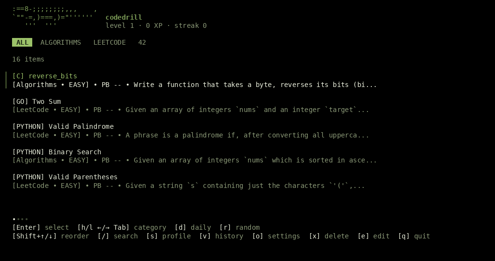

# codedrill

codedrill is a terminal app for timed coding practice. Pick a drill, solve it in your editor, and run its tests. Practice modes let you work with or without a reference solution.



## Install

You need bash, an editor, and the tools your drills use, such as a C compiler or Python. [Zellij](https://zellij.dev/) is optional; with it, codedrill opens the editor beside a terminal with sprint commands. Typing sounds are optional and need a PulseAudio-compatible server such as PipeWire.

With Nix and flakes enabled:

```bash
nix profile add github:luvcie/codedrill
codedrill
```

For a local checkout, run `nix profile add .` from the repository directory.

To uninstall, run `nix profile remove codedrill`. If you installed from a local directory with a different name, use `nix profile list` to find the profile name.

To build from source, you need Go 1.26.5 or newer:

```bash
git clone https://github.com/luvcie/codedrill.git
cd codedrill
go build -o codedrill ./cmd/codedrill
./codedrill
```

The executable is built in the current directory. Add it to your `PATH` to run `codedrill` from elsewhere.

## Quick start

1. Choose a drill from the menu and open its briefing.
2. Choose a practice mode with `1` to `4` or the arrow keys, then press Enter to start.
3. Write your solution in the editor. The student entry file starts empty.
4. With Zellij, run `r` in the terminal pane to check your work, then use `s` to submit. Without Zellij, close the editor to return to codedrill.
5. Read the test and reference results. You can resume the workspace from evaluation or retry with a fresh workspace after a completed run.

## Practice modes

| Mode | Reference visible | Passing requirement |
| --- | --- | --- |
| Study | Yes | Tests |
| Copy | Yes | Exact reference match |
| Recall | No | Exact reference match |
| Exam | No | Tests |

You can change the four options in the briefing: check the reference, show it, require an exact match, and require tests. Tests run on submission even when they are not required to pass. Copy and Recall need a C or C++ drill with a reference solution.

## Common commands

```sh
codedrill list                 # list drills
codedrill start ft_strlen      # open a drill's briefing
codedrill daily                # open today's drill
codedrill random               # choose a drill at random
codedrill config               # show settings and paths
```

In the Zellij sprint terminal, `r` runs tests, `p` shows your pace, and `s` submits. Use `m` for a reference score and `m -v` to open the reference when the selected mode allows it. See [commands and shortcuts](docs/commands.md) for the full list, including reset and viewer controls.

## Reference solutions

C and C++ drills can use reference solutions for scoring, exact-match checks, viewing, and token diffs. Attach a reference with `codedrill solution <id> <path>`, or compare a workspace with `codedrill match <id>`. The [reference guide](docs/reference.md) covers visibility, multi-file comparisons, and supported syntax.

## Exam Rank 05

The built-in `42/Exam 05` group includes `bigint`, `bsq`, `life`, `polyset`, and
`vect2`. Statements, tests, and reference solutions are embedded in the executable;
no import or existing config is needed. All four practice modes work immediately.

These are independently written practice materials, not official school files.
See [Exam 05 coverage and provenance](docs/exam05.md) for differences and test limits.
Existing local drills and reference attachments keep precedence.

The exercises need a C99 compiler, a C++11 compiler, and Python 3. The Nix package
supplies these tools and bash on its runtime path. Other installations use tools
from your `PATH`.

## Custom drills

Run `codedrill new` to create a drill, or `codedrill import drill.json` to import one. See [custom drills](docs/custom-drills.md) for the JSON format, student-owned files, and workspace reset behavior.

## Configuration

Run `codedrill config` to see the current settings and paths. You can change the editor, theme, sound, mouse support, countdown, pane shell, and typing sounds from the command line or the settings screen. See [configuration](docs/configuration.md) for defaults and editor selection.

### Typing sounds

Typing sounds are off by default and available on Unix-like systems. Open Settings with `o`, select `[ Typing Sounds ]`, choose a pack, and press Enter. The pack is downloaded on first use, previewed, and saved. Volume is adjusted with Left/Right, and the first row turns sounds on. Silent and Generated tones are included.

Word completion sounds are off by default. When enabled, a Space or Tab after a word of at least two letters plays the piece-lock sound. `{` and Enter play the piece lock, `}` plays the quad, and `;` moves to the next combo sound. The combo resets after 20 seconds without a semicolon.

The same settings are available from the command line:

```
codedrill config typing-pack sfx-Starcat_JP-8Bit_Puzzler
codedrill config typing-volume 70
codedrill config typing on
codedrill config typing-words on
codedrill config typing-keys '{,enter' ';' '}'
```

Packs come from their original hosts and are never bundled. The `.tpse` file and decoded clips are cached under `<cache dir>/codedrill/typing-sounds`. The first uncached download can take a few seconds; the editor opens immediately and sounds start when loading finishes. If the audio server or pack is unavailable, the editor runs without sounds. Bracketed paste is silent, and terminals that send paste as ordinary keys cannot be distinguished from typing. `CODEDRILL_TYPING_SOUNDS=prototype` forces the generated tones for one session.

After the editor closes, the Zellij pane shells keep the configured editor command routed through Codedrill's wrapper. `hx vect2.hpp` then keeps the sounds; an absolute editor path or shell alias bypasses the wrapper.

With sounds on, Helix gets a temporary config with `editor.auto-pairs = false`. Your config and Helix outside Codedrill are unchanged; an explicit `-c`/`--config` is left alone. A project `.helix/config.toml` can re-enable auto-pairs.
